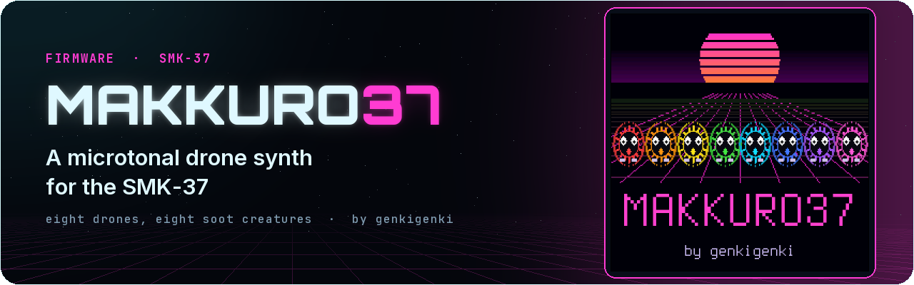
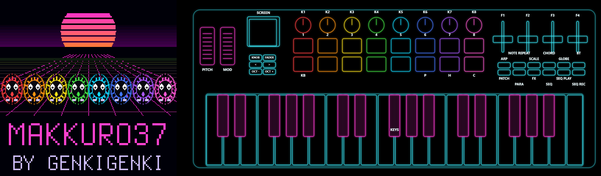

<p align="center"></p>

# Makkuro37



**A microtonal drone synth for the M-Vave SMK-37 (SMK-37 Pro, Elite or MKE-P37).**
Eight drones in eight columns, each a little soot creature on the screen. 96 presets in six themes, 16 places for
your own. One logic for every menu: a button opens it, K1-K8 set the eight columns, < > turn the pages.
Unofficial firmware, not affiliated with or endorsed by M-Vave. Install at your own risk.

[Guide](docs/GUIDE.md) · [Control map](docs/CONTROLS.md) · [Web installer](https://genkigenki.github.io/smk37/) · [Simulator](https://genkigenki.github.io/smk37/makkuro37-sim/)

## Install

- **Browser:** open the [web installer](https://genkigenki.github.io/smk37/) in Chrome or Edge, press Connect, then
  Install on Makkuro37.
- **Try it first:** the [simulator](https://genkigenki.github.io/smk37/makkuro37-sim/) runs the firmware's engine and
  screen in the browser.
- **Python:** connect the SMK-37 by USB, then

  ```
  python tools/fm1_install.py --yes makkuro37.fwsc
  ```

Installing clears another firmware's stored data on the keyboard (and the other way round).
To go back to the stock firmware, install it the same way. Rescue: hold OCT - while switching on.

## Build

```
sh build.sh                        # Linux / WSL: JieLi toolchain (tools/get_toolchain.sh)
sh tests/run_tests.sh OUTDIR       # engine renders, screens, board layer tests
sh web/sim/build.sh                # the simulator (Emscripten), then serve build/sim
sh tools/docs_img.sh               # the guide's screenshots; tools/docs_panels.sh: the panel images
```

## Credits

Inspired by the Moog Subharmonicon, the Horn of Abraxas and Abducted Drone.
Sound after Melodee by Kerem Kilic (ladder, tanh knee, limiter, spring reverb; GPL-3.0).
Board layer from SLOOP by isod89, based on Felucca by Leo Kuroshita.
Plate after J. Dattorro, "Effect Design 1" (1997). Terminus font (SIL OFL 1.1).

@genkigenki, licence: GPL-3.0 (see [LICENSE](LICENSE)).
