# Makkuro37: step by step

Eight lessons, about five minutes each. Do the step and listen.

Two buttons are always there for you: **KNOB BANK** shows the presets, **PATCH** takes you home to the
creatures. Hold **KNOB BANK** for HELP.

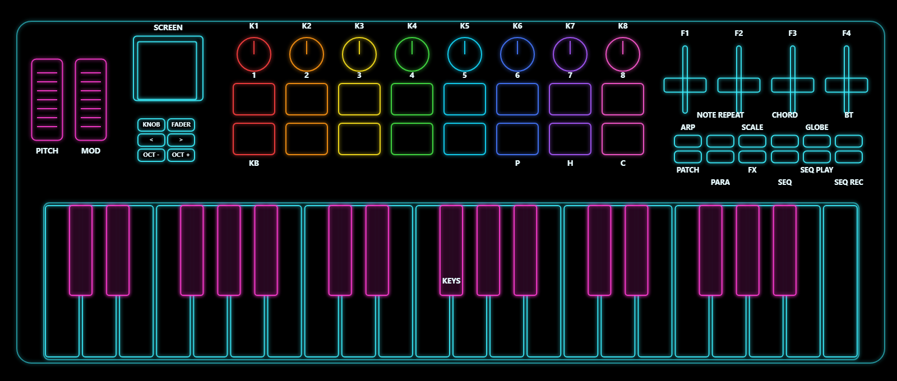

Every menu works the same way: its button opens it at page 1, **< >** turn the pages, knob **K1-K8** sets
column 1-8, and a setting with two choices sits on the column's pads. Two lines under each page say what it does.
The full map: [CONTROLS.md](CONTROLS.md).

---

## 1. First sound

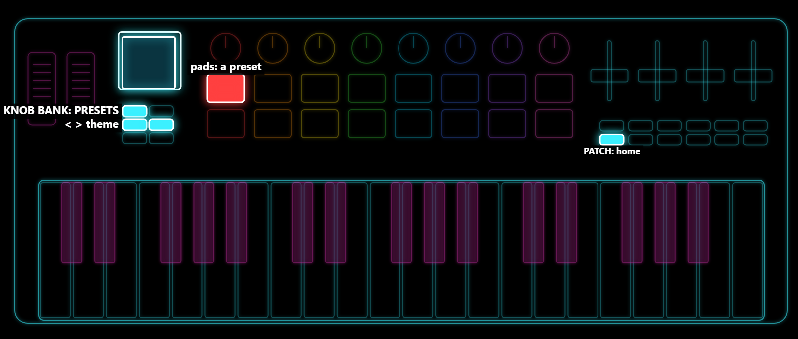

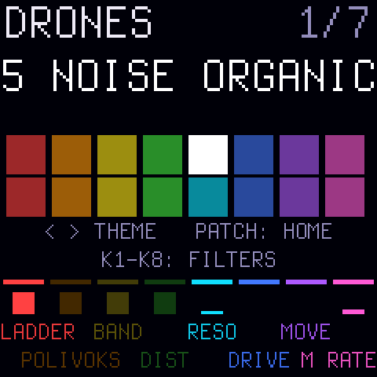

1. Switch on. After the boot scene you see **PRESETS**.
2. Tap any **pad**. You hear that preset straight away. The pad you are hearing is white.
3. Turn **K1-K4**: each is a filter type (LADDER, POLIVOKS, BAND, DIST). Turning one switches to it and sweeps
   its cutoff. **K5-K8**: resonance, drive, movement and its rate.
4. Press **<** or **>** to change the theme: DRONES, ABRAXAS, NATURE, SCI-FI, ORGAN, PULSE, MINE. The strip
   under the pads shows all seven, the one you are in white.
5. Press **PATCH**. You see the creatures. The awake ones are bright and singing, the sleeping ones dim. The
   first time, the screen says TAP A TOP PAD: WAKE / SLEEP until you tap one.
6. Press **KNOB BANK** to come back to the presets.

## 2. Tuning the creatures

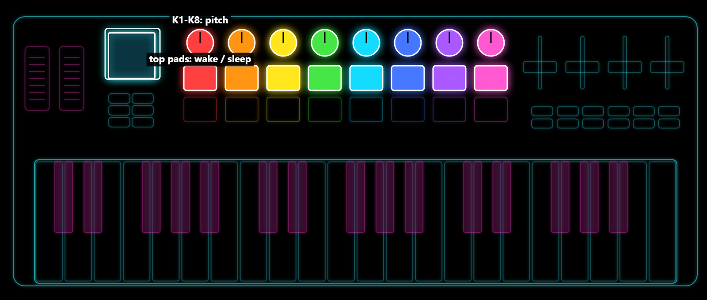

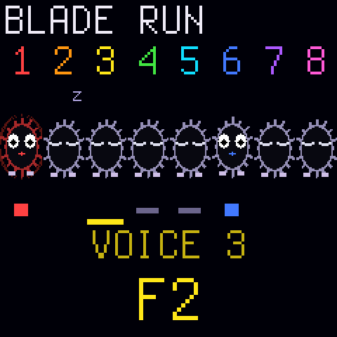

1. On the creatures screen, each column is one drone: knob above, creature and note in the middle, pad below.
2. Tap **top pad 3**. Creature 3 wakes up and sings.
3. Tap it again. It falls asleep (it fades out with its release) and turns dim, its note too. Tap once more
   right away: silent at once.
4. **Hold** top pad 3 instead. It sings only while you hold it.
5. Turn **K1**. Drone 1 moves up or down the scale. The note under creature 1 changes.
6. Hold **top pad 1** and play a **key**. Drone 1 takes that note, in its own register, and stays on.
7. Tap **KB** (bottom pad 1). SELECT VOICES blinks. Tap top pads 1, 2 and 6: PLAY KEYBOARD. One key tunes all
   three, each in its own register. Three keys together are spread over them: one note each. Tap **KB** again
   to finish.
8. On the creatures screen, **< >** step to the previous or next preset.

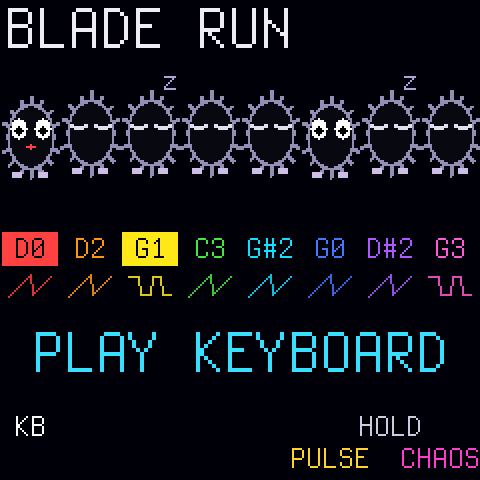

## 3. Faders and wheels

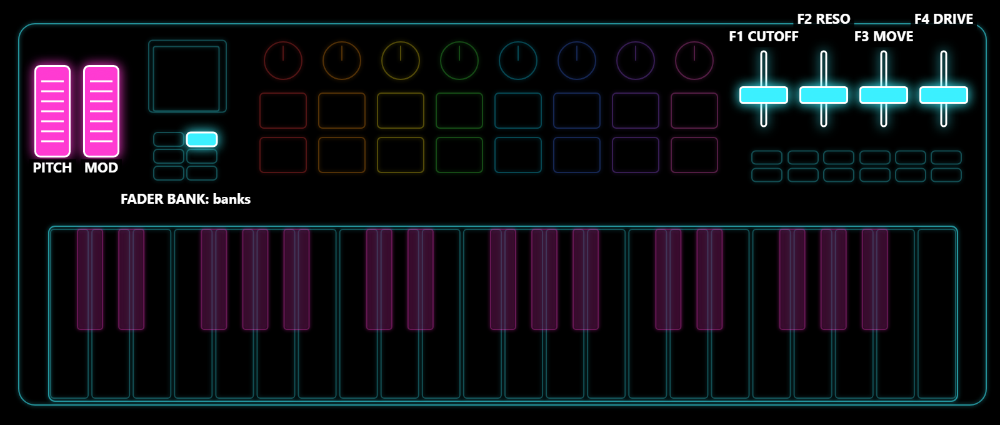

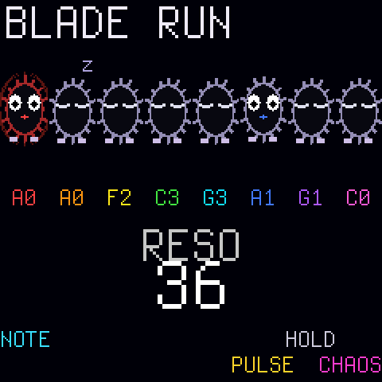

1. Raise **F1** (MIX) slowly. More of the left effect. Its value shows big on the screen.
2. Move **F2-F4** (X Y Z). They shape the effect.
3. Push the **MOD** wheel up. The filter closes. Move the **PITCH** wheel: everything bends, then springs back.
4. Press **FADER BANK**. You see the four faders: the bar is the value, the white line where the fader stands.
5. Press **>** (or a top pad 1–5) for the next bank. The faders now move that bank.

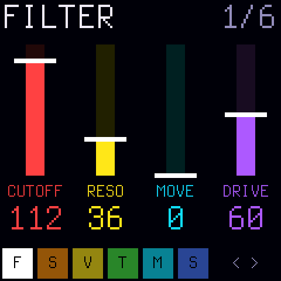

| Bank | F1 | F2 | F3 | F4 |
|---|---|---|---|---|
| FX L | mix | X | Y | Z |
| FX R | mix | X | Y | Z |
| LFO | A rate | A shape | B rate | B shape |
| PLAY | glide | vibrato | vibrato rate | arp rate |
| OUTPUT | master | width | tape | analog |

Every setting has one place. The faders hold the amounts for all voices, the knobs on PRESETS the filter, the
menus each voice's own settings and the choices (effect types, sources, scales). A fader sets its parameter when
you move it; switching banks changes nothing.

## 4. Menus

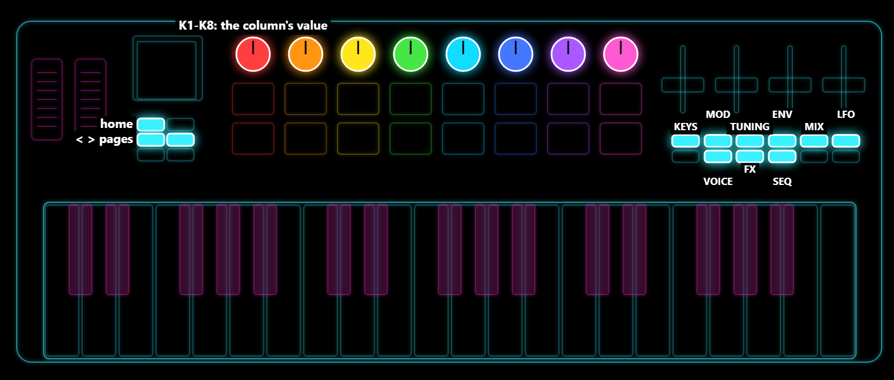

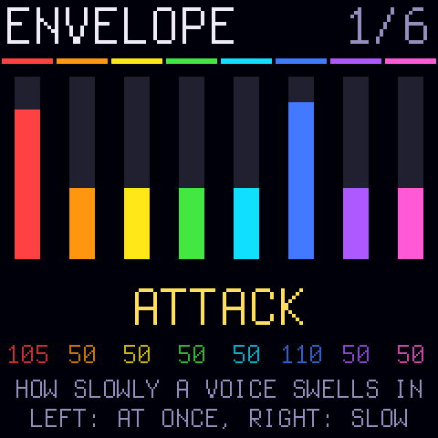

1. Press **CHORD**. You see ENVELOPE 1/6, page ATTACK, one bar per drone.
2. Turn **K1**. Drone 1's attack changes.
3. Press **>**. Page 2/6: RELEASE. Press **<** to go back.
4. Press **CHORD** again, or **PATCH**, to go home.
5. Try the other menus: **PARA** SOUND, **NOTE REPEAT** MOTION, **SCALE** TUNING, **FX** EFFECTS,
   **SEQ** SEQUENCER, **ARP** KEYS, **GLOBE** MIX.
6. **PARA** SOUND has one page per voice after WAVE: its number and kind in the header (V1 DRONE, V3 NOISE,
   V4 VCO), the page in its colour. Each voice's wave also shows small under its note at home.
7. In **PARA**, page V1 DRONE: K1-K5 tune the five oscillators. The top pads switch each one on or off,
   the bottom pads switch its modulation.

## 5. Free-play and hold

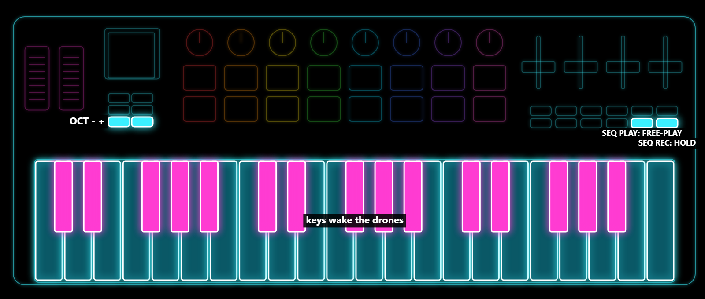

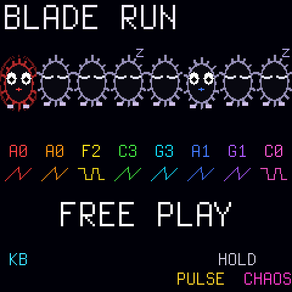

1. Press **SEQ PLAY**. The screen says FREE PLAY.
2. Play a **key**. Drone 1 wakes on that note.
3. Play more keys. Each key wakes the next drone, up to 8 at once.
4. Press **SEQ REC** (HOLD). Now the notes stay when you let go.
5. Press a sounding key again. That drone lets go.
6. Press **OCT -** or **OCT +** to move the keys an octave.
7. Press **SEQ PLAY** again. The keys play voices 4 and 5 again.

## 6. Sequencer and pulser

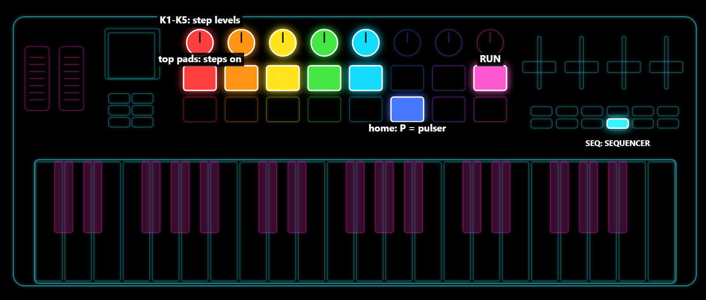

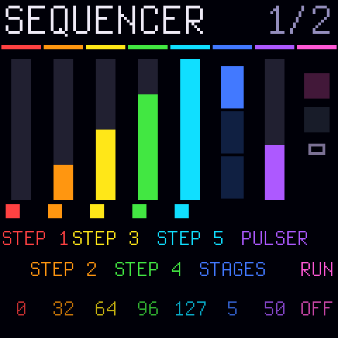

1. Press **KNOB BANK**, go to the theme PULSE and tap **MOTORIK**. It is already running.
2. Press **PATCH**. On the creatures screen, tap **P** (bottom pad 6) in rhythm. The tempo follows your taps.
3. Hold **P**. The pulser stops. Tap it to start again.
4. Press **SEQ**. Turn **K1-K5** to set the five step levels.
5. Tap the **top pads 1-5**. Each one switches a step on or off. The playing step is white.
6. Pad 8 is RUN: top on, bottom off.

## 7. Chaos, cascade, loop

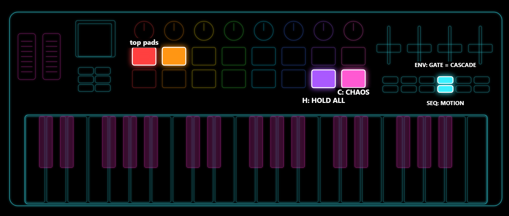

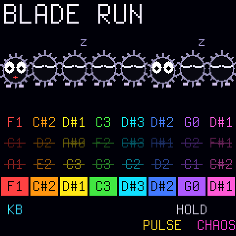

1. On the creatures screen, tap **C** (bottom right). Every drone rolls three notes in the scale, one after
   the other; you see and hear them. The third one stays (boxed).
2. Hold **C** and tap **top pad 2**. Only drone 2 rolls, all of its sound, and it wakes up.
3. Tap **H**. Everything that sounds now stays on. Tap **H** again: all off.
4. Press **CHORD**, then **>** to GATE. Turn K2 and K3 to CASCADE. Go home and wake drone 1.
   Drones 2 and 3 follow, one after the other.
5. Press **SEQ**, then **>** to LOOP. Tap **top pad 1**: it records. Go home, tap pads, turn knobs.
   Back in SEQ, LOOP: top pad 1 again plays it in a loop, again stops it.

## 8. Your own presets

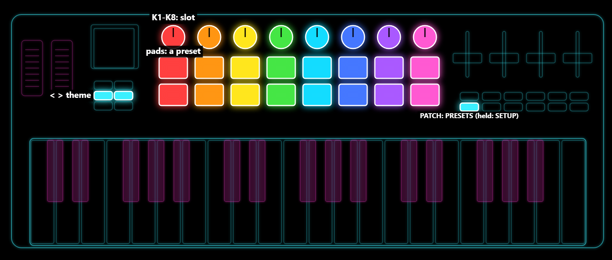

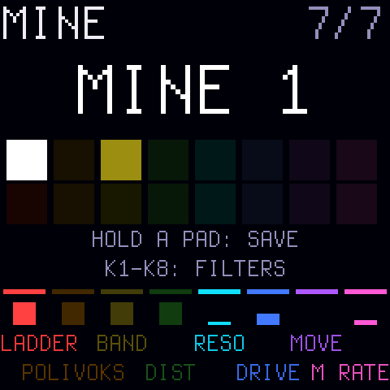

1. Make a sound you like.
2. Press **KNOB BANK**, then **<** or **>** until the theme **MINE**: 16 places for your sounds.
3. **Hold** a dark pad for one second. Your sound is saved there.
4. Hold a lit pad: the screen asks first. **Green** pad (bottom right) = replace, **red** = cancel.
5. Tap a lit pad to load your sound.
6. Hold **PATCH** for SETUP: pad light, USB console, output LINE or SPEAKER, and START: PLAY (a preset's
   voices start as it has them) or SILENT (every preset loads asleep, you wake the voices with their pads).
   Master volume, width, tape and analog drift are on the faders, bank OUTPUT.

---

## The screens

| | | |
|---|---|---|
| 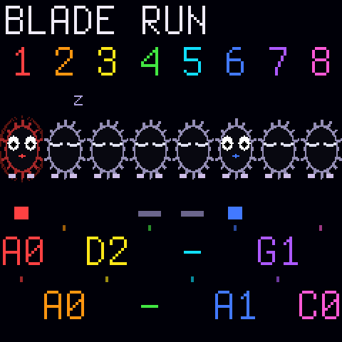 home | 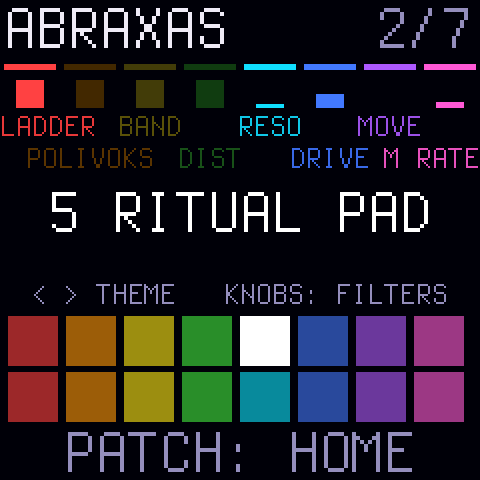 PRESETS | 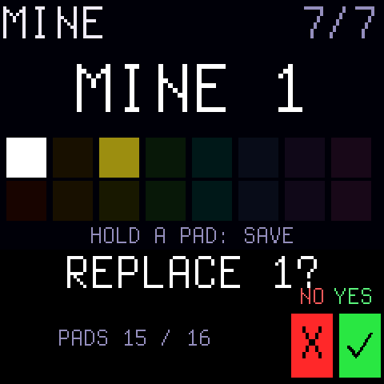 replace a saved one |
| 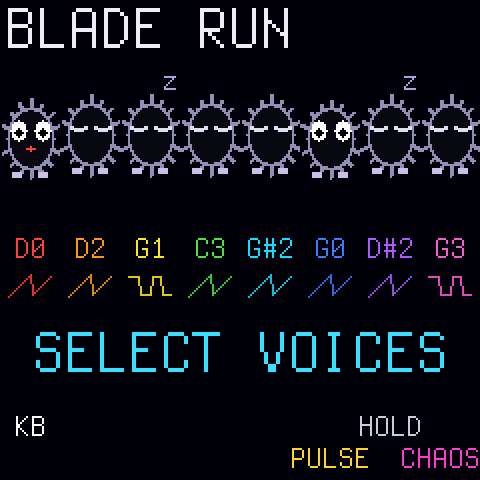 KB |  CHAOS |  FADER BANK |
| 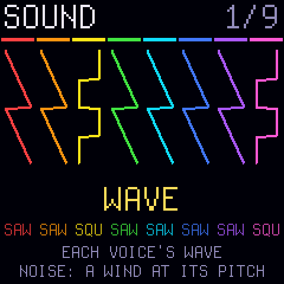 SOUND: WAVE | 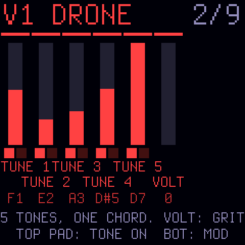 SOUND: V1 DRONE | 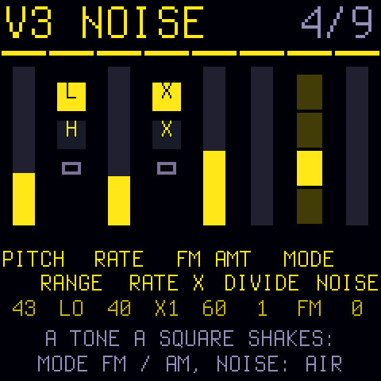 SOUND: V3 NOISE |
| 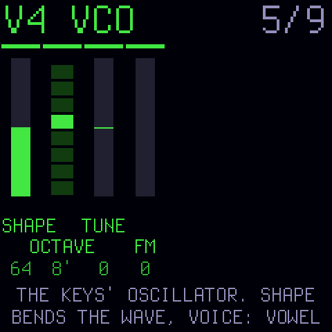 SOUND: V4 VCO | 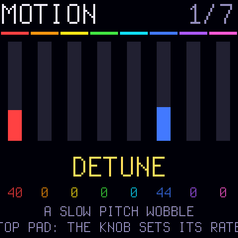 MOTION: DETUNE | 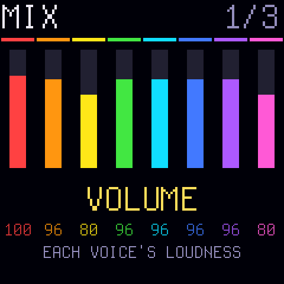 MIX: VOLUME |
| 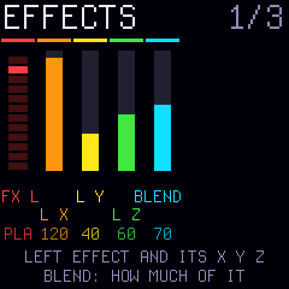 EFFECTS: TYPES | 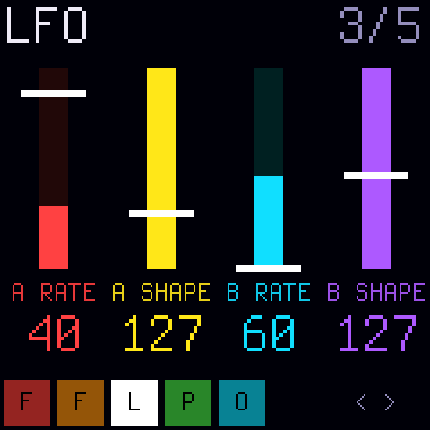 FADER BANK: LFO | 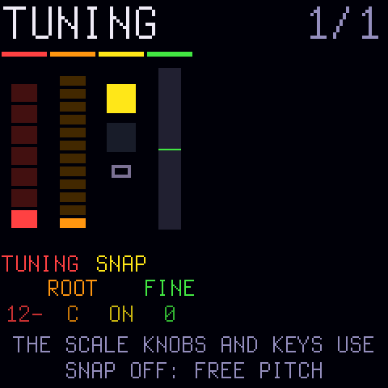 TUNING |
| 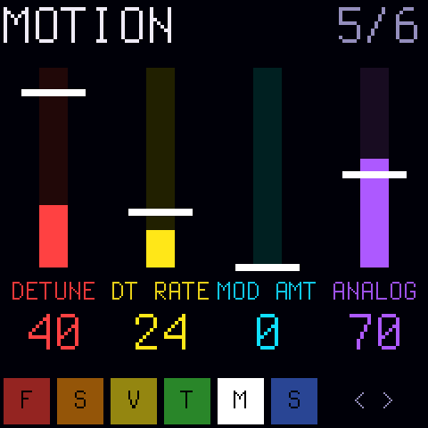 FADER BANK: OUTPUT | 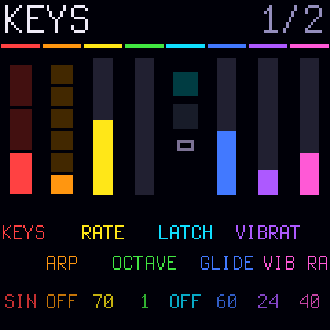 KEYS | 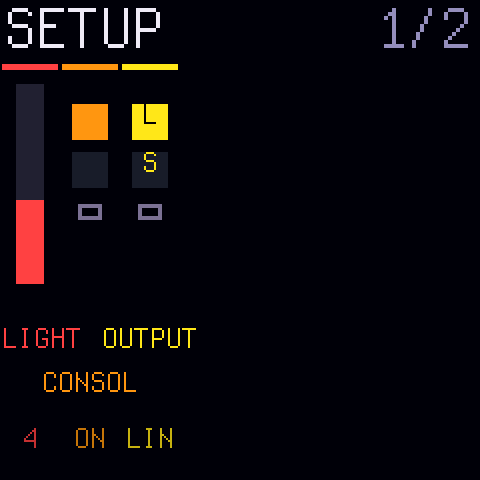 SETUP |
| 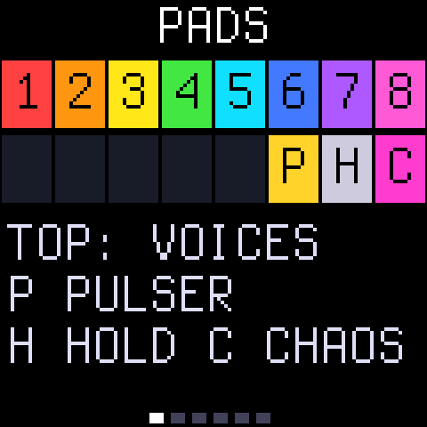 HELP: pads | 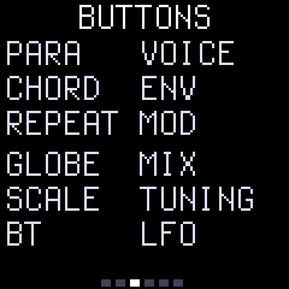 HELP: menus | 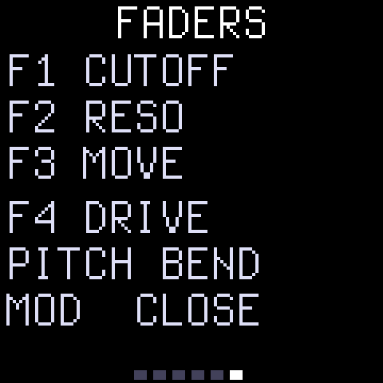 HELP: faders |

## Update mode

Hold **OCT -** and **OCT +** for 5 seconds. For USB rescue, hold **OCT -** while switching on.
