# Makkuro37: step by step

Eight lessons, about five minutes each. Do the step and listen.

Lost at any point? Tap **KNOB BANK** to go back to the creatures. Hold **KNOB BANK** for HELP.

---

## 1. First sound

1. Switch on. You see the boot scene, then **PRESETS**.
2. Tap any **pad**. You hear that preset straight away. The pad you are hearing is white.
3. Tap a few other pads.
4. Press **<** or **>** to change the theme: DRONES, ABRAXAS, NATURE, SCI-FI, ORGAN, PULSE.
5. Tap **KNOB BANK**. You see the creatures. The awake ones are singing.
6. **PATCH** takes you back to PRESETS.

## 2. Tuning the creatures

1. On the creatures screen, each column is one drone: knob above, creature and note in the middle, pads below.
2. Tap **top pad 3**. Creature 3 wakes up and sings.
3. Tap it again. It falls asleep.
4. **Hold** top pad 3 instead. It sings only while you hold it.
5. Turn **K1**. Drone 1 moves up or down the scale. The note under creature 1 changes.
6. Turn the other knobs. Each one tunes its own column.

## 3. Faders and the mod wheel

1. Move **F1** (CUTOFF) slowly down. The sound gets darker. Its value shows big on the screen.
2. Raise **F2** (RESO). The filter starts to sing.
3. Raise **F4** (LFO DEPTH), then move **F3** (LFO RATE). The filter sweeps on its own.
4. Push the **MOD** wheel up. The filter closes and the resonance rises.
5. Move the **PITCH** wheel. Everything bends, then springs back.
6. Press **FADER BANK**. Now the faders are FX L, FX R, SPACE and TAPE. Press it again for the filter.

The faders always win: where a fader stands is what you hear, even after loading a preset.

## 4. Menus

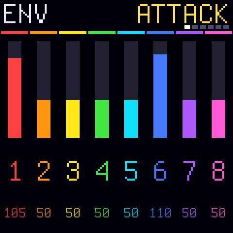

1. Press **CHORD**. You see ENV, page ATTACK, with one bar per drone.
2. Turn **K1**. Drone 1's attack changes. Every knob sets the bar under it.
3. Press **>**. Next page: RELEASE. Press **<** to go back.
4. Where a setting has only two choices, the column's **pads** set it: top pad = one, bottom pad = the other.
5. Press **CHORD** again (or KNOB BANK) to go home.
6. Try the other menus: **PARA** VOICE, **NOTE REPEAT** MOD, **GLOBE** MIX, **SCALE** TUNING, **BT** LFO,
   **FX** FX, **ARP** KEYS, **SEQ** SEQ.

## 5. Free-play and hold

1. Press **SEQ PLAY**. The screen says FREE PLAY.
2. Play a **key**. Drone 1 wakes on that note.
3. Play more keys. Each key wakes the next drone, up to 8 at once.
4. Press **SEQ REC** (HOLD). Now the notes stay when you let go.
5. Press a sounding key again. That drone lets go.
6. Press **OCT -** or **OCT +** to move the keys an octave.
7. Press **SEQ PLAY** again. The keys play voices 4 and 5 again.

## 6. Sequencer and pulser

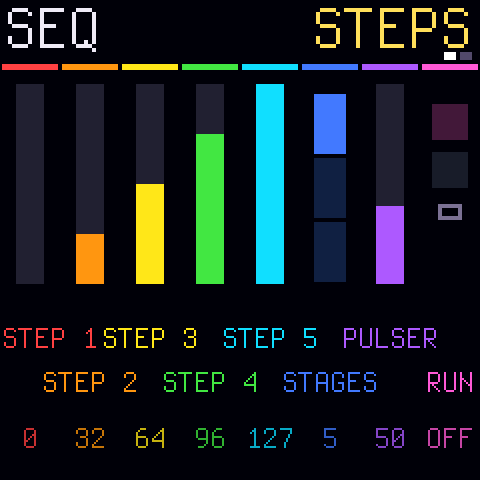

1. Open PRESETS, theme PULSE, and tap **MOTORIK**. It is already running.
2. Tap **P** (bottom pad 6) in rhythm. The tempo follows your taps.
3. Hold **P**. The pulser stops. Tap it to start again.
4. Tap the **bottom pads 1-5**. Each one switches a step on or off. The playing step is white.
5. Press **SEQ**. Turn **K1-K5** to set the five step levels.

## 7. Chaos, cascade, motion

1. Tap **C** (bottom right). All classic drones get new notes, still inside the scale.
2. Hold **C** and tap **top pad 2**. Only drone 2 changes.
3. Tap **H**. Everything that sounds now stays on. Tap **H** again: all off.
4. Press **CHORD**, then **>** to the GATE page. Turn K2 and K3 to CASCADE.
   Go home and wake drone 1. Drones 2 and 3 follow, one after the other.
5. Press **SEQ**, then **>** to MOTION. Turn **K1** right: it records. Tap pads, turn knobs.
   Turn K1 right again: it loops what you did. Again: it stops.

## 8. Presets and scenes

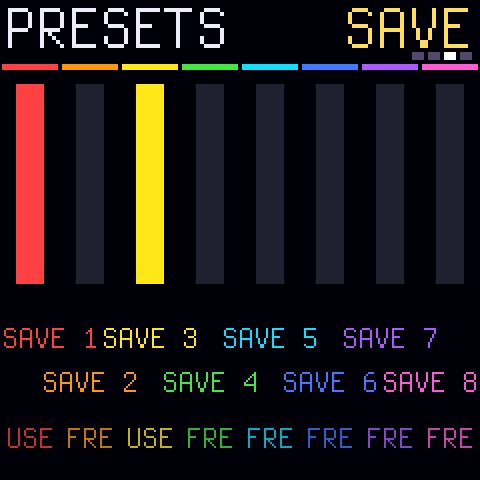

1. Press **PATCH**. Tap pads to pick a sound. Use **<** **>** for the themes.
2. Press **>** past the last theme (PULSE). You reach LOAD, then SAVE, then MORPH. One more **>** brings
   you back to the first theme.
3. **SAVE**: turn a slot's knob (K1-K8). An empty slot saves at once. A used slot asks first: green pad OK, red pad
   cancel.
4. **LOAD**: turn a slot's knob. That scene loads.
5. **MORPH**: turn a slot's knob slowly. Your sound glides into that scene.
6. Hold **PATCH** for SETUP: pad light, USB console, OUTPUT LINE or SPEAKER.

---

## The screens

| | | |
|---|---|---|
|  home |  PRESETS |  SAVE over a used slot |
| 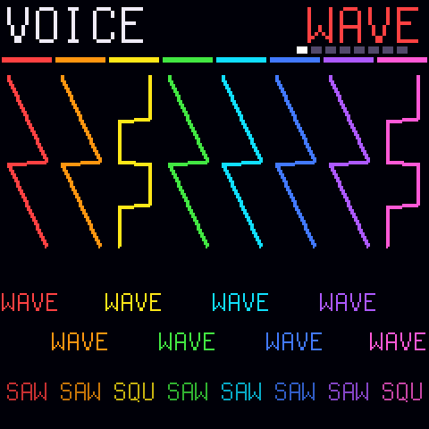 VOICE: WAVE | 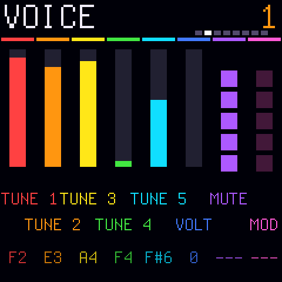 VOICE 1 | 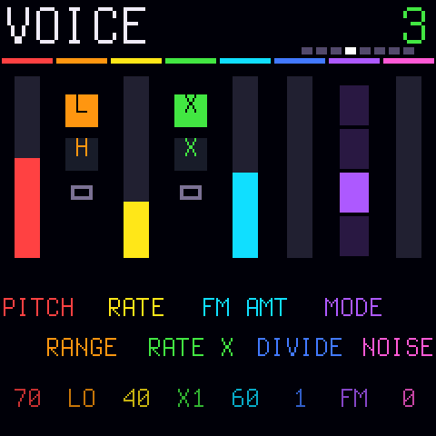 VOICE 3 (noise) |
| 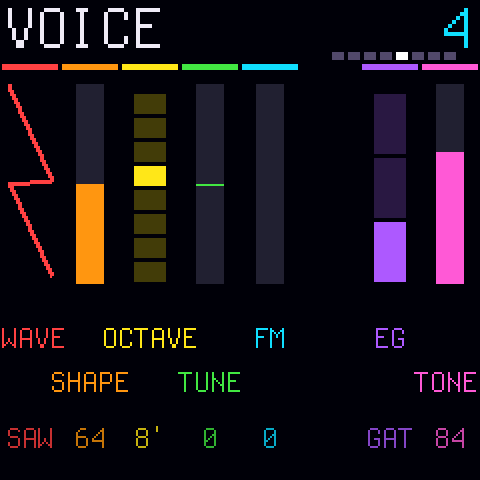 VOICE 4 (VCO) | 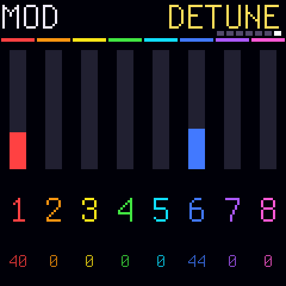 MOD: DETUNE |  MIX: VOLUME |
| 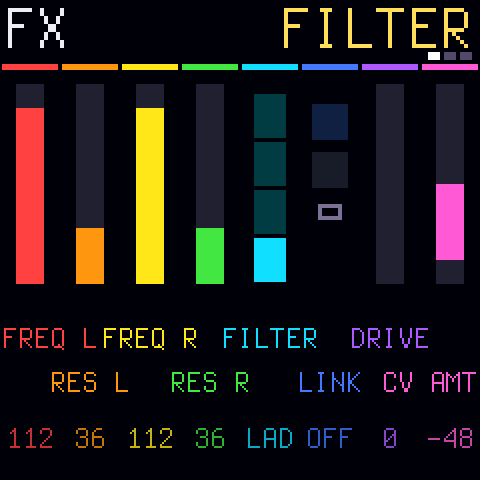 FX: FILTER | 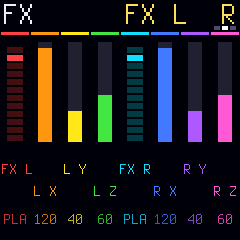 FX: L / R |  TUNING |
| 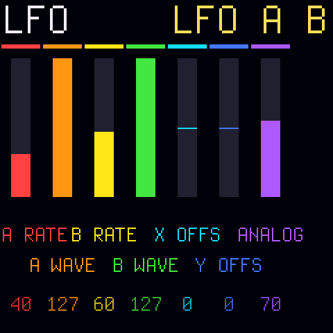 LFO |  KEYS |  SETUP |
|  HELP: pads |  HELP: buttons |  HELP: faders |

## Update mode

Hold **OCT -** and **OCT +** for 5 seconds. For USB rescue, hold **OCT -** while switching on.
